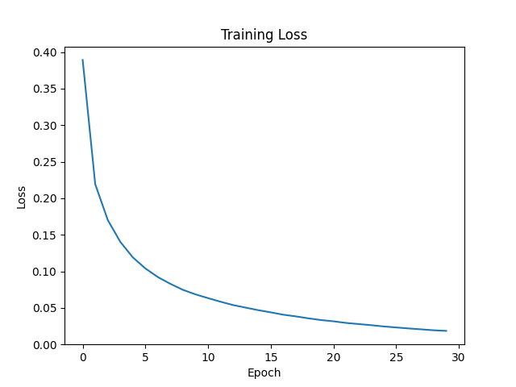

# Handwritten Digit Recognizer

A multi-class neural network built **from scratch using NumPy** to classify handwritten digits (0–9) from the MNIST dataset. No PyTorch or TensorFlow — just raw math.

## How It Works

- 2-layer neural network (784 → 64 → 10)
- **He initialization** for ReLU-friendly weight scaling
- ReLU activation in the hidden layer
- Softmax activation in the output layer
- Categorical cross-entropy loss
- **Mini-batch stochastic gradient descent** with manual backpropagation

## Project Structure

```
.
├── src/
│   ├── data_loader.py      # Fetches MNIST from OpenML
│   ├── preprocessing.py    # Normalizes, one-hot encodes, 80/20 split
│   ├── model.py            # Neural network (forward, backward, loss)
│   ├── train.py            # Mini-batch training loop and evaluation
│   ├── predict.py          # Classifies your own digit image
│   └── weights.npy         # Trained weights saved by train.py
├── assets/                 # Sample digits and the loss curve
├── requirements.txt
├── LICENSE
└── README.md
```

## Dataset

[MNIST 784](https://www.openml.org/d/554) via `sklearn.datasets.fetch_openml` — 70,000 grayscale images of handwritten digits, each 28×28 pixels.

## Setup

### 1. Clone and enter the project

```bash
git clone https://github.com/Parth-KG/MultiClass-Digit-Classification.git
cd MultiClass-Digit-Classification
```

### 2. Create and activate a virtual environment

**macOS / Linux:**
```bash
python3 -m venv venv
source venv/bin/activate
```

**Windows (PowerShell):**
```powershell
python -m venv venv
venv\Scripts\Activate.ps1
```

### 3. Install dependencies

```bash
pip install -r requirements.txt
```

### 4. Train the model

```bash
cd src
python train.py
```

### 5. Classify your own image

From `src/`:

```bash
python predict.py ../assets/3.png
```

`predict.py` loads `weights.npy`, shrinks the image to 28×28 grayscale and prints the predicted digit. Trained weights are included, so this works before you train. Like MNIST and the samples in `assets/`, digits should be light on a dark background.

## Training Details

The 70,000 images are split 80/20 with a fixed seed: 56,000 for training, 14,000 held out for testing. The training loop uses mini-batch SGD with shuffling each epoch. After each epoch, both the average loss and training accuracy are printed so you can monitor progress in real time.

| Hyperparameter | Value |
|----------------|-------|
| Architecture | 784 → 64 → 10 |
| Weight init | He initialization (`√(2 / fan_in)`) |
| Optimizer | Mini-batch SGD |
| Batch size | 64 |
| Epochs | 30 |
| Learning rate | 0.1 |

## Results

| | Before | After |
|--------|--------|-------|
| Weight init | `* 0.01` | He init |
| Optimizer | Full-batch GD | Mini-batch SGD |
| Epochs | 2000 | 30 |
| Learning rate | 0.005 | 0.1 |
| Gradient updates per run | 2,000 | ~26,000 |
| Test accuracy | 76.74% | **97.26%** |

97.26% is the committed `weights.npy` on the 14,000 held-out images; training accuracy is 99.59%.



## Why the Accuracy Jumped

Three small changes did almost all the work:

1. **He initialization** — scaling weights by `√(2 / fan_in)` keeps activations from collapsing to zero through ReLU layers, so gradients actually flow.
2. **Mini-batches** — instead of one weight update per epoch, the network now performs ~875 updates per epoch (with batch size 64 on ~56k training examples), giving roughly 13× more learning per training run.
3. **Larger learning rate** — He init plus mini-batch noise lets the optimizer take much bigger, more confident steps without diverging.

## Next Steps

Possible upgrades, in rough order of impact:

- Adam optimizer instead of vanilla SGD
- Add a second hidden layer (e.g., 784 → 128 → 64 → 10)
- Dropout for regularization
- Learning rate decay
- Convert to a small CNN (typically 99%+ on MNIST)

## Tech Stack

- Python
- NumPy
- scikit-learn (dataset only)
- Matplotlib (loss curve)
- Pillow (image loading in `predict.py`)

## Author

**Parth Krishan Goswami**  
B.Tech Information Technology, GGSIPU  
[GitHub](https://github.com/Parth-KG) · parthkrishangoswami@gmail.com
